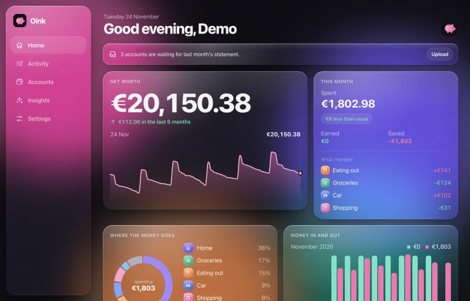
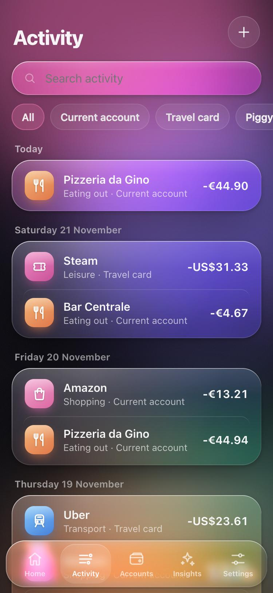

# Oink 🐷

**Self-hosted personal finance with real glass and an AI that does the boring part.**

Oink keeps all your money in one place (bank accounts, cards, cash, savings, crypto) on your
own server, for you and the people you invite. It syncs your bank automatically where it
can, reads exchanges and wallets with a read-only key, asks you for a statement where
nothing can be linked, sorts every movement into a category, spots subscriptions that
quietly got more expensive, and writes you a short report with advice at the start of each
month. Any AI provider works, or none at all.

<p align="center">
  
  
</p>

## What it does

- **Everyone gets their own Oink.** The first account is the admin; invite others with a
  one-time link. Each person's accounts, movements and reports are private.
- **Every currency, crypto included.** Accounts can be in EUR, USD, GBP, JPY… or BTC, ETH,
  SOL and friends. Totals and reports are converted to your main currency with free
  exchange rates (ECB for fiat, CoinGecko for crypto).
- **Link what can be linked, in one tap:**
  - **Banks** over PSD2 through [Enable Banking](https://enablebanking.com): 2,500+ European
    banks, free for your *own* accounts. Pick your bank, log in there, done.
  - **Exchanges** with a read-only API key: Kraken, Binance.
  - **Wise** with a personal API token (balances in every currency).
  - **Wallets** by public address: Bitcoin (balance and movements), Ethereum. No keys.
- **Statements for everything else.** Drop a CSV, OFX/QFX or PDF: the IBAN printed on it picks
  the account by itself. CSVs of European banks are read directly, PDFs by the AI or, without
  AI, by a line parser. Duplicates are skipped. You can also drop files in an inbox folder
  (`data/inbox/<username>/`) and Oink imports them every few minutes.
- **A monthly reminder**: on the 1st, every account without a link asks for last month's
  statement, and the request closes itself when the statement arrives.
- **Categories that learn**, each with its own icon: correct one once and Oink remembers it
  for that merchant. Whatever is left can be sorted by the AI.
- **Subscriptions and bills** are found automatically; price increases are flagged.
- **AI reports and questions**: a monthly report with three concrete tips, and a box to ask
  things like «can I afford a trip in March?». Oink computes the numbers; the AI only puts
  them into words.
- **An API for your other apps** with scoped tokens (read and write are separate), so an
  assistant can read your spending without being able to change anything. Docs at `/api/docs`.
- **Investments, with real market data**: ETFs, stocks, bonds, funds and crypto priced from
  Yahoo Finance (free, no key), accumulation plans (PAC), and a **simulator**: the plan on
  real history (backtest) and thousands of possible futures (Monte Carlo, block bootstrap
  of the asset's own returns or a normal model), for one asset or a weighted portfolio.
- **A personal money plan**: fixed costs (also suggested from your movements), a five-question
  risk profile, the whole picture (liquidity, emergency fund in months, saving rate,
  investments, plans) and AI advice built on it: how to split your income, what fits your
  profile, what to fix first.
- **AI configured from the app**: the admin picks provider, model and key (stored
  encrypted); `.env` still works.
- **Single sign-on**: any OpenID Connect provider (Keycloak, Authentik, Google…), with
  admins from a group; password sign-in can be turned off.
- **MCP server** at `/mcp`: plug Oink into Claude, ChatGPT or any MCP assistant with a scoped
  token (the assistant gets only the tools its scopes allow).
- **Updates in one click**: when a new release is out, the admin sees it and can press
  *Install and restart*. The database migrates itself.
- **English, Italiano, Deutsch, Français, Español**: your device's language by default.

## Design

Oink is meant to feel like an Apple app, on a phone first. The glass bends what is behind it,
it doesn't just blur it: each `Glass` surface uses an SVG displacement map that is strong at
the rim and flat in the centre, with a slight chromatic fringe, applied through
`backdrop-filter`. On top sit a specular highlight that follows your finger and a lit rim.
Browsers that can't run SVG filters in `backdrop-filter` (Safari and Firefox today) get the
frosted version. Everything moves on springs (framer-motion) and respects *reduce motion*.
Add it to your home screen: it runs full screen like an app.

## Run it

```bash
mkdir oink && cd oink
curl -O https://raw.githubusercontent.com/Peppe37/oink/main/docker-compose.yml
curl -o .env https://raw.githubusercontent.com/Peppe37/oink/main/.env.example
docker compose up -d        # http://localhost:8080
```

Open it and create the first account (or set `OINK_ADMIN_PASSWORD` in `.env`). Data live in
`./data` (SQLite, plus the key that encrypts API keys of linked accounts): back that folder
up and keep the backups private.

### One-click updates (optional)

```bash
docker compose --profile updater up -d
```

starts a tiny sidecar that, when the admin presses *Install and restart*, pulls the new image
and recreates the Oink container. It needs the Docker socket, which is root-equivalent on the
host: if you'd rather not, leave it off and update with `docker compose pull && docker compose
up -d` when the app tells you a version is out.

### AI (optional)

Set `OINK_AI_MODEL` to any [LiteLLM](https://docs.litellm.ai/docs/providers) model id, and
add that provider's usual key:

| Provider | `OINK_AI_MODEL` | Key |
| --- | --- | --- |
| OpenAI | `openai/gpt-5.4-mini` | `OPENAI_API_KEY` |
| Anthropic | `anthropic/claude-sonnet-5-5` | `ANTHROPIC_API_KEY` |
| DeepSeek | `deepseek/deepseek-chat` | `DEEPSEEK_API_KEY` |
| Ollama (local) | `ollama/llama3.1` | `OINK_AI_BASE_URL=http://ollama:11434` |

Privacy: with `OINK_AI_SEND_DESCRIPTIONS=false` only totals per category are sent: no
descriptions, no merchant names. PDF reading by the AI and AI categories need descriptions,
so they are off in that mode (PDFs are then read by the line parser).

### Bank sync (optional)

The admin does this once, in the app: **Settings → Bank access**.

1. Create an account at [enablebanking.com](https://enablebanking.com), then an application in
   *restricted production* (personal use: only accounts you link yourselves).
2. Register the redirect URL the app shows you (`<OINK_PUBLIC_URL>/api/connections/callback`).
3. Paste the application ID and the private key. Oink checks them before saving.

From then on everyone links their banks from **Accounts → Add account → Bank**. Consents last
up to 180 days; Oink syncs every `OINK_SYNC_HOURS` (6 by default).

## Single sign-on (Keycloak and friends)

Create an OpenID Connect client (confidential or public with PKCE) with redirect URI
`<OINK_PUBLIC_URL>/api/auth/oidc/callback`, then set `OINK_OIDC_ISSUER` (for Keycloak
`https://<host>/realms/<realm>`), `OINK_OIDC_CLIENT_ID`, `OINK_OIDC_CLIENT_SECRET`. Members of
`OINK_OIDC_ADMIN_GROUP` (group or realm role) are admins. Existing users can link their
account from Settings → Profile.

## Connect an AI assistant over MCP

Create a token in **Settings → Connected apps**, then point the assistant at `<OINK_PUBLIC_URL>/mcp`:

```json
{ "mcpServers": { "oink": { "type": "http", "url": "https://oink.example.com/mcp",
  "headers": { "Authorization": "Bearer oink_…" } } } }
```

## Connect another app (e.g. an AI assistant)

Go to **Settings → Connected apps**, create a token, and tick only the scopes the app needs:

| Scope | Allows |
| --- | --- |
| `accounts:read` / `accounts:write` | see / manage accounts and balances |
| `transactions:read` / `transactions:write` | see / add, correct and categorise movements |
| `imports:write` | upload statements |
| `requests:read` / `requests:write` | see / skip the monthly statement requests |
| `reports:read` / `reports:write` | read statistics and reports / generate AI reports |
| `ai:ask` | ask the AI about your finances |
| `connections:read` / `connections:write` | see linked banks and wallets / start a sync |

Then call the API with `Authorization: Bearer oink_…`. A token acts for the user who made it.
Amounts are exact decimal strings in the account's currency (`"-12.50"`, `"0.00031250"`);
reports are numbers in the user's main currency. A few useful endpoints:
`GET /api/reports/overview`, `GET /api/requests`, `POST /api/imports` (multipart: `file`,
optional `account_id`), `POST /api/ask`. Linking a bank or a key, managing tokens and people
are only possible from a signed-in browser.

## Development

```bash
cd backend && uv sync && uv run pytest -q          # API (FastAPI, SQLite, SQLAlchemy, Alembic)
OINK_DATA_DIR=/tmp/oink uv run python -m oink.demo  # demo user «demo» / «demo-password»
OINK_DATA_DIR=/tmp/oink uv run oink
cd frontend && npm install && npm run dev          # web app (React, Vite), proxies /api
```

Checks: `uv run ruff check src tests && uv run mypy src && uv run pytest -q` and `npm run build`.
A schema change ships an Alembic revision in `backend/src/oink/migrations/versions`.
Translations live in `frontend/src/i18n/`: copy `en.ts`, translate, and add it to `LANGUAGES`.
Releases: push a `vX.Y.Z` tag; the image goes to `ghcr.io/peppe37/oink`.

## Similar projects

[Firefly III](https://github.com/firefly-iii/firefly-iii), [Actual](https://github.com/actualbudget/actual)
and [Ghostfolio](https://github.com/ghostfolio/ghostfolio) are excellent and more mature. Oink
aims to be smaller and more automatic: the bank and the AI do the bookkeeping, and you get the
picture.

## License

[AGPL-3.0](LICENSE). You can use it, change it and host it. If you offer it to others as a
service, you share your changes.
