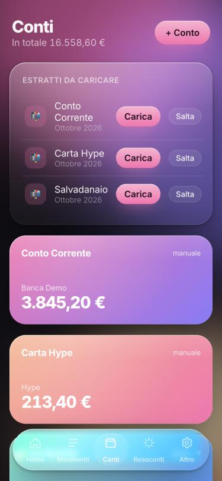

# Oink 🐷

**Self-hosted personal finance with real glass and an AI that does the boring part.**

Oink keeps all your money in one place (bank accounts, cards, cash, savings) on your own
server. It syncs your bank automatically where it can, asks you for a statement where it
can't, sorts every movement into a category, spots subscriptions that quietly got more
expensive, and writes you a short report with advice at the start of each month. Any AI
provider works, or none at all.

<p align="center">
  
  
</p>

> The interface is in Italian for now; translations are welcome.

## What it does

- **All accounts in one view**: net worth, balance over time, income and spending per month,
  where the money goes, and how this month compares to your usual.
- **Bank sync over PSD2** through [Enable Banking](https://enablebanking.com): free for
  linking your *own* accounts, and it covers 2,500+ European banks. Consents last up to 180 days.
- **Statements for everything else**: drop a CSV export or a PDF. CSVs from Italian and
  European banks are read directly; PDFs and unusual layouts are read by the AI. Duplicates are
  skipped, so uploading the same file twice is harmless.
- **A monthly reminder**: on the 1st, every account without a bank link asks for last month's
  statement, and the request closes by itself when you upload it.
- **Categories that learn**: correct a category once and Oink remembers it for that merchant.
  Whatever is left can be sorted by the AI.
- **Subscriptions and bills**: recurring payments are found automatically, and price
  increases are flagged.
- **AI reports and questions**: a monthly report with three concrete tips, plus a box to ask
  things like «can I afford a trip in March?». The numbers are computed by Oink; the AI only
  puts them into words.
- **An API for your other apps** with scoped tokens (read and write are separate), so an
  assistant can read your spending without being able to change anything.
  Docs at `/api/docs`.

## Design

Oink is meant to feel like an Apple app. The glass bends what is behind it, it doesn't just
blur it. Each `Glass` surface uses an SVG displacement map that is strong at the rim and flat
in the centre, with a slight chromatic fringe, applied through `backdrop-filter`. On top of that
sit a specular highlight that follows your finger and a lit rim. Browsers that can't run SVG
filters in `backdrop-filter` (Safari and Firefox today) get the frosted version instead.
Everything moves on springs (framer-motion), and it all respects *reduce motion*.

## Run it

```bash
cp .env.example .env        # set OINK_PUBLIC_URL, and optionally AI and bank keys
docker compose up -d        # http://localhost:8080
```

On first open you choose the password; alternatively set `OINK_ADMIN_PASSWORD`.
Data lives in `./data` (SQLite). Back that folder up.

### AI (optional)

Set `OINK_AI_MODEL` to any [LiteLLM](https://docs.litellm.ai/docs/providers) model id, and
add that provider's usual key:

| Provider | `OINK_AI_MODEL` | Key |
| --- | --- | --- |
| OpenAI | `openai/gpt-5.4-mini` | `OPENAI_API_KEY` |
| Anthropic | `anthropic/claude-sonnet-5-5` | `ANTHROPIC_API_KEY` |
| DeepSeek | `deepseek/deepseek-chat` | `DEEPSEEK_API_KEY` |
| Ollama (local) | `ollama/llama3.1` | `OINK_AI_BASE_URL=http://ollama:11434` |

Privacy: with `OINK_AI_SEND_DESCRIPTIONS=false` only totals per category are sent: no
descriptions, no merchant names. PDF reading and AI categories need descriptions, so they
are off in that mode.

### Bank sync (optional)

1. Create an account at [enablebanking.com](https://enablebanking.com), then an application
   in *restricted production* (personal use: only accounts you link yourself).
2. Register `https://<your OINK_PUBLIC_URL>/api/banks/callback` as a redirect URL.
3. Save the private key as `data/enablebanking.pem` and set `OINK_ENABLE_BANKING_APP_ID`.
4. In Oink: **Altro → Banche collegate**, search for your bank, then log in on your bank's page.

Oink then syncs every `OINK_SYNC_HOURS` (6 by default).

## Connect another app (e.g. an AI assistant)

Go to **Altro → App collegate**, create a token, and tick only the scopes the app needs:

| Scope | Allows |
| --- | --- |
| `accounts:read` / `accounts:write` | see / manage accounts and balances |
| `transactions:read` / `transactions:write` | see / add, correct and categorise movements |
| `imports:write` | upload statements |
| `requests:read` / `requests:write` | see / skip the monthly statement requests |
| `reports:read` / `reports:write` | read statistics and reports / generate AI reports |
| `ai:ask` | ask the AI about your finances |
| `banks:read` / `banks:write` | see bank links / trigger a sync |

Then call the API with `Authorization: Bearer oink_…`. A few useful endpoints:
`GET /api/reports/overview`, `GET /api/requests`, `POST /api/imports` (multipart:
`account_id`, `file`), `POST /api/ask`. Connecting a bank is only possible from the owner's
browser, and tokens can never create other tokens.

## Development

```bash
cd backend && uv sync && uv run pytest -q          # API (FastAPI, SQLite, SQLAlchemy)
OINK_DATA_DIR=/tmp/oink uv run python -m oink.demo  # eight months of demo data
OINK_DATA_DIR=/tmp/oink OINK_ADMIN_PASSWORD=demo-password uv run oink
cd frontend && npm install && npm run dev          # web app (React, Vite), proxies /api
```

Checks: `uv run ruff check src tests && uv run mypy src && uv run pytest -q` and `npm run build`.

## Similar projects

[Firefly III](https://github.com/firefly-iii/firefly-iii), [Actual](https://github.com/actualbudget/actual)
and [Ghostfolio](https://github.com/ghostfolio/ghostfolio) are excellent and more mature. Oink
aims to be smaller and more automatic: the bank and the AI do the bookkeeping, and you get the
picture.

## License

[AGPL-3.0](LICENSE). You can use it, change it and host it. If you offer it to others as a
service, you share your changes.
